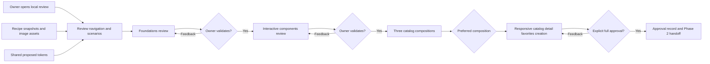

# Phase 1: Collaborative Culinary Magazine Design - Research

**Researched:** 2026-10-22
**Domain:** Interactive design-system review, responsive editorial prototypes, staged owner approval
**Confidence:** MEDIUM — primary documentation retrieved; subjective visual decisions deliberately remain review proposals.

<user_constraints>
## User Constraints (from CONTEXT.md)

Source: `01-CONTEXT.md`, read in this session. The following decisions are copied verbatim; they are constraints, not research hypotheses.

### Locked Decisions

#### Magazine Identity
- **D-01:** Use a bold, colorful gourmet pop identity.
- **D-02:** Use a light cream page background, dark text and large vivid accent blocks.
- **D-03:** Explore a tomato, pink and lemon yellow palette. Exact shades remain subject to visual review and accessible contrast.
- **D-04:** Use very bold, rounded titles and sober, comfortable body typography. Exact fonts remain subject to review.
- **D-05:** Propose several French magazine names for selection during the foundations review; the product name is not settled.

#### Design System and Approval Sequence
- **D-06:** Create a complete design system first, presented as an interactive browser page. Cover foundations, components and states needed by catalog, detail, favorites and creation.
- **D-07:** Obtain feedback and validation in two stages: visual foundations (colors, typography and shapes), then interactive components and their states, including hover, focus, error and loading.
- **D-08:** After the DS reviews, present three distinct catalog compositions using the same DS, on mobile and desktop. Compare layouts within the chosen identity rather than reopening three unrelated visual identities.
- **D-09:** Extend the preferred catalog composition to recipe detail, favorites and creation, with their relevant states on mobile and desktop.
- **D-10:** Incorporate owner feedback and require explicit approval of the complete responsive screen direction and DS before Phase 2 final interface implementation.

#### Photos and Catalog Composition
- **D-11:** Prioritize large immersive food photography.
- **D-12:** The preferred catalog opening features one recipe in a large photo, followed by a regular grid of large recipe cards. Keep search and filters quickly accessible.
- **D-13:** Present featured recipe title and information in a cream block overlapping the photo.
- **D-14:** Cards display total time and cuisine alongside the photo, recipe title and favorite control. Difficulty remains a filter; it was not selected as card metadata.
- **D-15:** Use this composition as the preferred starting direction for the three examples; layout variations should remain meaningfully distinguishable and reviewable.

#### Responsive Interaction
- **D-16:** Mobile uses bottom navigation with icons and labels for catalog, favorites and recipe creation. Review the actual rendering in mockups.
- **D-17:** Mobile filters open in a panel through a Filters button. Group cuisine, difficulty and maximum total time, and apply explicitly with “Voir les recettes”. Name search remains directly accessible.
- **D-18:** Mobile recipe detail is a continuous scrolling page: photo, information, ingredients and ordered preparation steps, with quick links to ingredients and preparation.
- **D-19:** Mobile creation uses one scrolling page organized into information, ingredients and preparation sections.

#### Existing Product Constraints
French interface; English code, identifiers, filenames and comments. Recipe content supplied by the API may retain its original language. Creation success follows a successful response and must not promise durable storage. Preserve keyboard access, visible focus, accessible feedback and reduced-motion behavior throughout design.

### Agent's Discretion
No explicit blanket delegation was given. Propose precise fonts, shades, spacing, shapes, icons, motion and desktop arrangements within this brief for owner review. Responsive details remain subject to the mockup feedback process. Do not ask the owner to choose implementation architecture.

### Deferred Ideas (OUT OF SCOPE)
None — discussion stayed within phase scope.
</user_constraints>

<phase_requirements>
## Phase Requirements

| ID | Description | Research Support |
|----|-------------|------------------|
| DES-01 | The project owner can review culinary magazine visual directions and responsive mockups, provide feedback, and approve the direction before final interface implementation. | Staged review sequence, deterministic review surface, screen/state matrix and versioned approval record below. |

The description above is copied from REQUIREMENTS.md. Later catalog, reading, favorites, creation and accessibility requirements inform mockup coverage; this phase does not claim their production implementation.
</phase_requirements>

## Summary

**Recommendation:** Build a clearly labeled, local React design-review surface with deterministic recipe fixtures, shared CSS tokens, real semantic controls and explicit scenario selectors. Present foundations, then components, then three catalog layouts, then the complete responsive journey. Record owner feedback and approval against the reviewed artifact revision. This is a proposed implementation approach within D-06–D-10, not an additional locked visual decision.

The scaffold builds successfully with `npm run build`; the observed output reports Vite 8.3.5. `npm run lint` exits successfully but includes warnings from the bundled GSD tools; `node_modules/.bin/oxlint src` passes without output. [VERIFIED: commands executed 2026-10-22] Avoid introducing a router, remote cache, production forms or persistence solely to review screen designs. The phase's functional slice is owner review and feedback; the first demonstrable slice should be a browser-accessible foundations page rather than unreviewable token documents.

Use static snapshots adapted from the official recipe examples for realistic image crops, long names, ingredient lists and time/cuisine metadata. DummyJSON documents recipe imagery and a simulated creation endpoint; creation does not persist on its server. [CITED: https://dummyjson.com/docs/recipes] A prototype success scenario must be labeled as a demonstration and must never appear to confirm an actual POST.

## Architectural Responsibility Map

The following ownership assignments are research recommendations derived from the design-only boundary.

| Capability | Primary Tier | Secondary Tier | Rationale |
|------------|--------------|----------------|-----------|
| Foundations, component states, responsive screens | Browser / Client | Static assets | Actual rendering and keyboard behavior are the review artifact. |
| Scenario selection and temporary favorite/filter/form interaction | Browser / Client | — | Deterministic local state demonstrates intended interaction. |
| Recipe text and photographs | Static fixtures/assets | DummyJSON documentation/CDN | Snapshot examples; screen review must not depend on request latency. |
| Feedback and approval | Versioned planning documents + owner conversation | Browser review links/screenshots | Human approval is durable evidence, not an application state toggle. |
| Real POST, remote caching, durable favorites | Later phases | — | Outside this phase's implementation responsibility. |

## Project Constraints (from AGENTS.md)

The following are directives from AGENTS.md read in this session, rather than externally sourced claims:

- Work through the invoked GSD planning/execution workflow before changing repository files.
- Keep React and the existing TypeScript/Vite workspace; the assistant implements everything.
- Use French interface text and English identifiers, filenames, code and comments.
- Preserve DummyJSON as the eventual catalog and submission source; successful creation requires a successful response and no durable-storage promise.
- Provide owner feedback opportunities before final interface implementation.
- Add libraries for concrete use cases, with compatibility checks; preserve existing tooling where suitable.
- CSS Modules and custom properties are the recommended initial styling approach; complex interactive behavior uses semantic HTML or selected accessible primitives.
- Do not implement custom dialog/select accessibility, ad hoc production fetch effects, competing transition wrappers or a durable catalog entry from a simulated POST.
- No established product component conventions or architecture are declared; scaffold styling is not an approved DS.

## Standard Stack

No external package installation is recommended for this design-only phase. Existing dependency ranges are recorded as manifest facts, not independently registry-verified latest versions.

| Technology | Existing declaration | Phase use | Provenance |
|------------|----------------------|-----------|------------|
| React / React DOM | `"react": "^19.3.1"`, `"react-dom": "^19.3.1"` | Interactive review UI and local scenario state | [VERIFIED: package.json:12-15] |
| TypeScript / Vite | `"typescript": "~6.0.3"`, `"vite": "^8.3.4"` | Typed fixtures and local preview/build | [VERIFIED: package.json:25-27] |
| CSS Modules + CSS custom properties | Browser/Vite feature; no added package | Scoped prototype styles and shared semantic tokens | [CITED: https://vite.dev/guide/features.html#css-modules] |
| Native HTML controls and modal dialog | Browser platform | Inputs, buttons, panel semantics | [CITED: https://www.w3.org/WAI/WCAG22/Techniques/html/H102] |

**Installation:** None. Preserve the lockfile. Reassess package versions in the feature phase that first installs them.

**Package Legitimacy Audit:** Not applicable: no packages added. Introducing any dependency changes this condition and requires the package-legitimacy and registry/postinstall checks before installation. A component explorer service or full app router is unnecessary for the proposed review surface.

## Architecture Patterns

### System Architecture Diagram



### Proposed Project Structure

The paths in this tree are **proposed new files**, not claims about existing files. Use equivalent English names if the planner chooses another isolated prototype entry point.

```text
design-review/                # Optional separate Vite HTML entry
src/design-review/
  DesignReviewApp.tsx         # Review navigation, scenario selection
  foundations/               # Palette, type, spacing, shape demonstrations
  components/                # Shared review components
  screens/                   # Catalog variants and chosen journey screens
  fixtures/                  # Deterministic recipe samples
  tokens.css                 # Proposed then approved semantic tokens
  review.module.css          # Review chrome distinct from product screens
```

Use a separate Vite HTML entry or an explicitly labeled review shell. The execution plan must select and document one exact launch URL, build command and entry point; the existing build must actually include/typecheck the prototype. Do not leave an unreachable folder of mockups. Keep final application bootstrapping gated by D-10.

### Pattern 1: One token source, many review scenarios

Proposal: primitive palette tokens feed semantic roles such as page, text, accent surface, focus, border and error. All components and the three catalog variants consume the same token source. Show color pairings and real text specimens, not only swatches. Proposed names for owner review can include “Mijoté”, “À table !” and “Plein Goût”; these are proposals, not selected branding.

For typography, show two or three exact candidate pairings with accented French text, numerals, long recipe names and body paragraphs. Choose font assets only after checking their official distribution/license; include fallback behavior. No font family or color hex value is locked by this research. Font choice belongs to the foundations checkpoint under D-04.

### Pattern 2: Deterministic state gallery

Proposal: visible review controls select each screen and its state without forcing the owner to trigger failures or wait for real network calls. Keep review controls outside the product mockup and label simulated submissions. Stateful controls must still work: favorites toggle locally, filter panel opens/closes and applies drafts explicitly, ingredient and step rows add/remove, and scenario navigation remains keyboard operable. React supports event handlers passed to JSX controls. [CITED: https://react.dev/learn/responding-to-events]

### Pattern 3: Sequential review gates with feedback evidence

Derived from D-07–D-10: split execution into foundations → components → catalog choice → complete screens and final approval. Stop at each relevant human checkpoint, incorporate feedback, then resume the next stage. The initial brief, a passing build or an agent's visual verdict cannot count as owner approval. The configured end-of-phase verification preference must not flatten the explicitly requested intermediate reviews.

Proposed approval record fields: review stage, artifact URL and revision, viewport examples, owner feedback verbatim, resulting changes, unresolved items and explicit decision. Final approval must identify the accepted DS, selected composition and complete responsive screens; later visual changes require reconciliation with that approval. Do not prepopulate approval or mark DES-01 complete while awaiting a response.

### Catalog comparison specification

Proposed variations within the locked identity: A uses a full-width lead image and centered cream overlap; B uses an offset overlap and asymmetric editorial opening before the regular grid; C uses a taller lead crop with a broad lower overlap and a different search/filter placement. Preserve the same content, tokens, card metadata, clear search and subsequent regular card grid in all three. Variation must be structural, not three accent-color swaps. Review each on mobile and desktop, and record selection before extending the other screens.

### Required coverage matrix

This matrix translates the roadmap and locked brief into proposed review deliverables; it does not expand production scope.

| Surface | Required review states | Interaction evidence |
|---------|------------------------|----------------------|
| Foundations | Cream/dark text, tomato/pink/lemon roles, type, spacing, shapes, imagery, icon and motion specimens | Name and font selection; color-pair contrast results |
| Shared components | Default, hover, focus, selected, disabled, loading, error | Buttons, fields, selects, cards, favorite control, navigation, feedback |
| Catalog A/B/C | Representative loaded content on mobile and desktop | Large feature photo + cream overlap, regular grid, time and cuisine, favorite control |
| Selected catalog | Loading, no results, request error/retry, search/filter-active, pagination | Direct search; mobile grouped filters with draft/apply/reset; bottom navigation |
| Detail | Loaded, loading, unavailable, request error/retry, favorite on/off | Continuous mobile scroll; ingredients/preparation anchors and ordered steps |
| Favorites | Populated and explanatory empty state; unavailable item/image fallback if shown | Local toggle demonstration; no persistence claim in prototype |
| Creation | Initial, filled, field errors, row add/remove, pending, failure retaining values/retry, simulated success | One scrolling page; information, ingredients, preparation; announced feedback |
| All screens | Mobile and desktop; narrow intermediate widths; reduced motion | Visible keyboard focus; bottom bar never hides fields, errors or focused controls |

## Don't Hand-Roll

| Problem | Avoid | Use instead | Source |
|---------|-------|-------------|--------|
| Modal filter interaction | A styled div plus a partial focus trap | Native dialog opened with showModal, labeled and explicitly closable | [CITED: https://www.w3.org/WAI/WCAG22/Techniques/html/H102] |
| Browser controls | Clickable decorative elements | Buttons, links, labels, inputs and native selects | [CITED: https://react.dev/learn/responding-to-events] |
| Responsive review | Fixed-width screenshot frames as the only mobile evidence | Render actual fluid pages and resize the viewport | [CITED: https://www.w3.org/WAI/WCAG22/Understanding/reflow.html] |
| Feature infrastructure | Real API/cache/form/store implementations for visual scenarios | Local fixture-driven demonstrations; defer production integrations | Design-only recommendation based on phase boundary |

## Common Pitfalls

1. **Premature application delivery.** Building API catalog, production routes or storage before approval would cross D-10. Verify a clear prototype label and fixture-based scenarios; no real recipe POST during review.
2. **Reviewing everything at the end.** A combined approval screen defeats the requested foundations/component feedback sequence. Make each prerequisite review an explicit dependency and checkpoint.
3. **Colorful but inaccessible pairings.** WCAG requires at least 4.5:1 for ordinary text and 3:1 for large text; evaluate actual foreground/background pairs, especially white labels on tomato or pink and text over photos. [CITED: https://www.w3.org/WAI/WCAG22/Understanding/contrast-minimum.html]
4. **Fixed navigation obscures content.** Leave room for bottom navigation and safe areas, test visible focus and creation fields near the page end. Focus visibility and reflow are explicit WCAG topics. [CITED: https://www.w3.org/WAI/WCAG22/quickref/]
5. **Tiny favorite/remove controls.** WCAG 2.2 minimum pointer targets are 24 by 24 CSS pixels subject to listed exceptions. Proposal: use a more comfortable 44px control size for these mockups and review it visually; do not call 44px the AA minimum. [CITED: https://www.w3.org/WAI/WCAG22/Understanding/target-size-minimum.html]
6. **Native dialog assumed automatically complete.** Supply an accessible name, a close button, deliberate initial focus and test Escape and focus return; native behavior still requires correct composition. [CITED: https://developer.mozilla.org/en-US/docs/Web/HTML/Reference/Elements/dialog]
7. **Realistic success copy implies persistence.** Proposed mockup copy: “Recette envoyée. L’API de démonstration ne conserve pas cet ajout.” Place the review-only simulation indicator outside product content; eventual live success is response-gated. [CITED: https://dummyjson.com/docs/recipes]

## Code Examples

Illustrative new prototype code, not excerpts from existing source. API behavior is documented by the linked sources.

### Native filter panel opening

```tsx
// Source: https://www.w3.org/WAI/WCAG22/Techniques/html/H102
// Illustrative prototype code; attach the ref to a labeled native dialog.
const panelRef = useRef<HTMLDialogElement>(null)

<button type="button" onClick={() => panelRef.current?.showModal()}>
  Filtres
</button>
<dialog ref={panelRef} aria-labelledby="filter-heading">
  <h2 id="filter-heading">Filtrer les recettes</h2>
  {/* Render labeled draft controls and an explicit apply button here. */}
  <button type="button" onClick={() => panelRef.current?.close()}>
    Fermer
  </button>
</dialog>
```

Use explicit React import for useRef. The final apply handler must commit the draft selections and close the panel; merely displaying an open dialog does not demonstrate D-17.

### Reduced-motion review specimen

```css
/* Source: https://developer.mozilla.org/en-US/docs/Web/CSS/Reference/At-rules/@media/prefers-reduced-motion */
@media (prefers-reduced-motion: reduce) {
  .recipeCard {
    transition: none;
  }
}
```

This example disables only the illustrative component's transition. Audit all actual prototype motion, including loading shimmer and scrolling; no production page-transition library is needed in this phase.

## State of the Art

- Native dialog provides browser-managed modal focus behavior; W3C documents the technique. Avoid duplicating that behavior in a custom overlay. [CITED: https://www.w3.org/WAI/WCAG22/Techniques/html/H102]
- Reduced-motion media queries expose the user's motion preference. Include that state in the interactive DS review rather than treating motion as unconditional decoration. [CITED: https://developer.mozilla.org/en-US/docs/Web/CSS/Reference/At-rules/@media/prefers-reduced-motion]
- Use WCAG 2.2 criteria as design checks; automated/build checks cannot decide owner visual preference. [CITED: https://www.w3.org/WAI/WCAG22/quickref/] The last clause is the research recommendation for DES-01.

## Assumptions Log

No unsupported factual claim is being promoted to a locked decision. Proposed palette shades, fonts, product names, spacing, 44px target preference, file layout and composition variations remain proposals within the explicitly requested owner review process. Browser availability for execution was not verified and must be checked before promising automated visual evidence. [ASSUMED]

| # | Claim | Section | Risk if Wrong |
|---|-------|---------|---------------|
| A1 | A browser will be available for execution-time rendering checks | Environment/validation | Use owner browser review when no automation tool exists; document unavailable checks rather than claiming success. |

## Open Questions

1. **Name, fonts, exact colors and shapes — [RESOLVED: METHOD]:** Plan 01-01 Task 2 presents concrete proposals and Task 3 records the owner's choices under D-03–D-05. Aesthetic values remain pending owner review.
2. **Preferred catalog composition — [RESOLVED: METHOD]:** Plan 01-03 presents three same-DS responsive compositions; Task 3 requires the owner to select A, B or C. The selection remains pending that checkpoint.
3. **Final responsive approval — [RESOLVED: METHOD]:** Plan 01-05 incorporates feedback and identifies the final revision; Task 3 requires explicit owner approval of the DS and complete responsive screens. Approval remains pending; neither research nor the accepted brief grants it.
4. **Photograph/font asset robustness — [RESOLVED: METHOD]:** Plan 01-01 Task 2 records source, license, local usage, availability and a visible fallback for every selected font and photograph before the foundations checkpoint. Asset selection remains pending those checks and owner review.

## Environment Availability

| Dependency | Available | Observation | Fallback |
|------------|-----------|-------------|----------|
| Node.js / npm | Yes | v26.12.0 / 11.20.0 from executed version probes | — |
| Existing build toolchain | Yes | npm run build passed; Vite output 8.3.5 | — |
| Linter | Yes | npm run lint exits 0 with GSD warnings; scoped oxlint src passes | Use scoped lint for prototype files, report baseline warnings |
| Context7 MCP / ctx7 CLI | Not found in available tools / command probe | Official docs fetched through built-in web tool | Official primary-source browsing used |
| Browser automation | Not verified | No browser run performed during research | Owner opens local Vite review URL and follows checklist |
| Live DummyJSON requests | Not required for review | Documentation retrieved; real GET/POST compatibility left to feature phases | Local snapshots and image fallback |

No execution blocker is established by these probes. Do not install an entire browser-test stack solely to satisfy a fictional unit-test requirement for visual approval.

## Validation Architecture

Nyquist validation is enabled: the config contains `"nyquist_validation": true`. [VERIFIED: .planning/config.json:20-25] The appropriate oracle for DES-01 is owner review evidence; automated tooling supports reachability and structural quality.

### Test Framework

| Property | Value |
|----------|-------|
| Framework | Existing TypeScript build + Oxlint; manual browser review |
| Config | Existing Vite/TypeScript settings; no dedicated test script in the opened manifest |
| Quick run command | `node_modules/.bin/oxlint src` |
| Full automated command | `npm run build` |
| Browser acceptance | Open the documented review URL, inspect each scenario and follow keyboard/responsive checklist |

Manifest scripts quote: `"dev": "vite"`, `"build": "tsc -b && vite build"`, `"lint": "oxlint"`, `"preview": "vite preview"`. [VERIFIED: package.json:6-10] These commands were exercised except preview/dev server launch. Build and scoped lint each completed in less than 30 seconds in this session.

### Phase Requirements → Test Map

| Req ID | Behavior | Test type | Command/evidence | Existing? |
|--------|----------|-----------|------------------|-----------|
| DES-01 | Review surface compiles and is reachable | Build + browser smoke | npm run build; launch dev and open documented URL | Build exists; review surface not yet created |
| DES-01 | Foundations then components can be reviewed | Manual acceptance | Owner feedback and explicit staged validation record | Planned |
| DES-01 | Three distinct catalog layouts share the DS on mobile/desktop | Manual comparison | Six rendered views plus selection record | Planned |
| DES-01 | All key screens/states are reviewable | Manual scenario matrix | Every coverage-matrix row reachable without real POST | Planned |
| DES-01 | Keyboard, focus, reduced motion and narrow layout are represented | Browser acceptance | Tab/Shift+Tab, Escape, focus return; resize; motion preference | Planned |
| DES-01 | Final DS/screens approved before Phase 2 | Human approval gate | Owner's explicit approval tied to artifact revision | Pending owner |

### Sampling Rate

- Per prototype task: scoped lint, build if TS/CSS/entry wiring changed, then inspect the affected rendered state.
- Per review stage: verify all current scenarios, keyboard behavior and mobile/desktop examples before requesting owner feedback.
- Phase gate: complete matrix, incorporated feedback and explicit final approval; passing automated checks alone is insufficient.

### Wave 0 Gaps

- Create a reachable prototype entry and document its exact review URL and launch command.
- Create deterministic screen/scenario fixtures and an inventory matching the coverage matrix.
- Establish feedback/approval artifact and a repeatable browser checklist.
- Proposal: review at 390px and 1440px, plus narrow 320px and a tablet/intermediate width; these are review samples, not locked CSS breakpoints. Reflow's 320 CSS-pixel criterion is documented by W3C. [CITED: https://www.w3.org/WAI/WCAG22/Understanding/reflow.html]
- No new unit-test framework required for aesthetic approval. If a later task introduces substantial reusable logic, test that behavior in its owning feature phase.

## Security Domain

Security is enabled by `"security_enforcement": true`, with `"security_asvs_level": 1`. [VERIFIED: .planning/config.json:48-50] This section describes scope applicability, not a security certification.

ASVS's official project page identifies stable 5.0.0; therefore avoid silently applying legacy category numbers as current ASVS 5 identifiers. [CITED: https://owasp.org/projects/asvs] The workflow's V2/V3/V4/V5/V6 labels below are explicitly **legacy conceptual labels**, used only to answer its requested applicability checklist.

| Legacy category label | Applies to prototype? | Proposed control |
|-----------------------|-----------------------|------------------|
| V2 Authentication | No: no accounts in scope | Do not create auth or request credentials |
| V3 Session Management | No: fixture review has no authenticated session | Use transient review state |
| V4 Access Control | No: no private backend or user roles | Keep local review artifacts non-sensitive |
| V5 Input Validation | Yes, limited demonstration surface | Treat recipe strings as text; design validation/error feedback; no real submit |
| V6 Cryptography | No custom cryptography | No secrets, tokens or encryption implementation |

These applicability decisions derive from the phase boundary and product exclusions, not from an assertion that controls are universally unnecessary. Production API validation belongs to later phases.

| Threat pattern | STRIDE | Prototype mitigation recommendation |
|----------------|--------|-------------------------------------|
| Untrusted recipe/form content interpreted as markup | Tampering | Render plain text; no raw HTML injection |
| Unintended POST during scenario review | Tampering | Local fixture scenarios; no real submission transport |
| External asset unavailable or changed | Denial of service | Snapshot fixtures, stable sources and intentional image fallback |
| Review leaks private data | Information disclosure | Only public recipe examples and synthetic form inputs |

## Sources

All online sources below were opened or returned by primary-source search in this session. Source pages were retrieved on 2026-10-22; publication dates were not supplied for several living documentation pages, so no publication-date claim is made. The confidence seam returned MEDIUM for websearch with verification; findings use CITED tags accordingly. Research-plan digests were cached for accessibility, dialog/motion and DummyJSON documentation.

- https://www.w3.org/WAI/WCAG22/quickref/ — focus, status feedback, contrast and responsive criteria.
- https://www.w3.org/WAI/WCAG22/Understanding/contrast-minimum.html — text contrast.
- https://www.w3.org/WAI/WCAG22/Understanding/reflow.html — 320 CSS-pixel reflow and zoom.
- https://www.w3.org/WAI/WCAG22/Understanding/target-size-minimum.html — target-size criterion and exceptions.
- https://www.w3.org/WAI/WCAG22/Techniques/html/H102 — native dialog focus/modal behavior.
- https://developer.mozilla.org/en-US/docs/Web/HTML/Reference/Elements/dialog — dialog behavior and author responsibilities.
- https://developer.mozilla.org/en-US/docs/Web/CSS/Reference/At-rules/@media/prefers-reduced-motion — motion preference.
- https://dummyjson.com/docs/recipes — recipe examples, images and simulated creation.
- https://react.dev/learn/responding-to-events — event-handler model.
- https://vite.dev/guide/features.html#css-modules — CSS Modules support.
- https://owasp.org/projects/asvs — official ASVS identity and stable version.
- Local sources opened: AGENTS.md, CONTEXT.md, REQUIREMENTS.md, ROADMAP.md, STATE.md, PROJECT.md, config.json, package.json, Vite configuration and scaffold source. No graph context was injected: graphify status reports disabled.

## Metadata

**Confidence breakdown:** Existing toolchain HIGH (executed build/lint); documented browser/accessibility patterns MEDIUM (primary sources, seam tier); visual choices intentionally pending owner review; browser automation availability unverified.

**Research date:** 2026-10-22
**Refresh condition:** Before adding packages, changing prototype infrastructure or relying on browser support not checked here. Recheck living documentation if execution is delayed more than 30 days.
